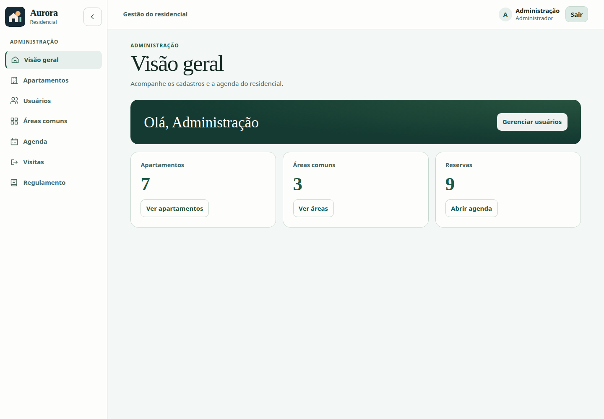
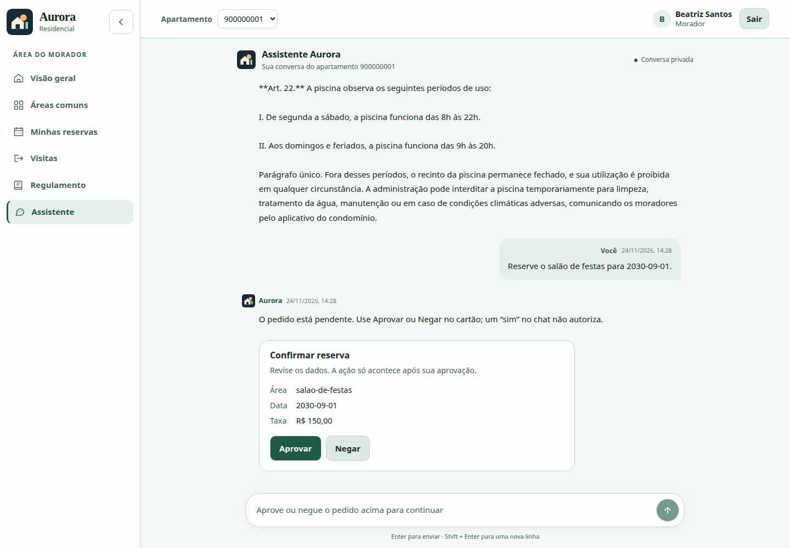

<div align="center">
  
  <br /><br />
  
</div>

# Residencial Aurora

Assistente virtual para reservar áreas comuns, cancelar reservas do próprio apartamento, autorizar visitantes e consultar o regulamento do condomínio. Projeto do desafio **Regra é regra**, do MBA de IA da Full Cycle.


O portal autenticado reúne administração, cadastros, agenda, visitas e conversa do morador. A API local do desafio oferece as seis rotas do avaliador, com dados separados do portal. Google ADK **2.14.1** coordena principal e especialistas; Gemini é configurado pelo operador. Código disponível, verificação automática e aceite humano são estados distintos. O aceite humano permanece pendente até uma decisão explícita sobre o candidato avaliado.

## Arquitetura

Um único [Compose](configs/compose.yaml) inicia frontend React/Nginx, oito APIs de produto, bancos e preparadores, além do gateway e duas réplicas da API acadêmica. O navegador usa a mesma origem em `127.0.0.1:8770`; o avaliador usa `127.0.0.1:8000`. As rotas acadêmicas são locais e não autenticadas e permanecem vinculadas a loopback, sem acesso aos dados do portal.

Cada aplicação segue **router → controller → validators → repository ORM → serializer**. Schemas validam entradas e saídas, validators verificam identidade e regras, e repositories concentram transações e constraints. A API acadêmica segue o mesmo padrão. [microservice-toolkit](infra/packages/microservice-toolkit) fornece HTTP, erros, correlação, health e infraestrutura ORM; [aurora-toolkit](infra/packages/aurora-toolkit) fornece identidade, permissões e tipos próprios do residencial.

### Principal e especialistas

O [runtime acadêmico](services/agent/api/runtime.py), em `AcademicRuntime.__init__`, compõe os três agentes na mesma sessão ADK. O portal usa a mesma divisão em [MultiAgentActionRuntime](services/agent/runtime/multi_agent_actions.py) e [MultiAgentReadRuntime](services/agent/runtime/multi_agent_read.py). O roteamento da API acadêmica está em [ROUTING_INSTRUCTION](services/agent/runtime/routing.py).

| Agente | Papel e acionamento | Por que existe |
| --- | --- | --- |
| `principal` | Recebe a mensagem e transfere a execução para o especialista da intenção. Não fornece identidade nem escolhe outra unidade. | Separa interpretação da intenção das ferramentas e regras de cada domínio. |
| `reservas` | É acionado para disponibilidade em uma data, listagem, criação e cancelamento de reservas. Consulta ferramentas com apartamento vinculado no servidor. | Mantém disponibilidade e efeitos de reserva no domínio, incluindo taxa, confirmação de cobrança e exclusividade no banco. |
| `convivencia` | É acionado para regulamento, horários de funcionamento, visitantes e autorização de entrada. Consulta o trecho pertinente e as ferramentas de visitas. | Distingue uma regra de uso da disponibilidade de uma data e mantém o regulamento fora do prompt principal. |

O modelo propõe chamadas. O servidor fixa unidade e titular, autoriza, exige decisão externa quando necessária e grava os efeitos. No portal, o principal extrai uma delegação tipada; o servidor valida os dados, calcula o especialista e vincula seu executor ao pedido atual. A resposta vem do resultado de domínio e do ledger, preservando o histórico. O [protocolo de F09](docs/specs/F09-chat-agente/spec.md#protocolo-interno-de-delegação) e o [ADR-0009](docs/adr/ADR-0009-delegacao-tipada-e-recibos-do-servidor.md) detalham validação, deduplicação e falhas seguras. Um “sim” no chat não substitui a rota de confirmação. Uma pergunta sobre o horário permitido da piscina vai a convivência; uma pergunta sobre uma data livre para reservar vai a reservas.

### Serviços, fronteiras e dados

As rotas abaixo são relativas à origem do portal, exceto a API acadêmica. Os contratos completos ficam nas specs ligadas em cada linha.

| Serviço | Responsabilidade e fronteira | Rotas principais | Dados e dependências |
| --- | --- | --- | --- |
| [auth](docs/specs/F03-autenticacao/spec.md) | Autentica e revoga sessões; introspecção interna exige bearer **e** `X-Aurora-Internal-Token`. | POST `/api/auth/login`, GET `/api/auth/me`, POST `/api/auth/logout`; GET `/internal/identity` privado | Contas e sessões em `identity-db`; JWT HS256 com validade de 3600 s. |
| [users](docs/specs/F04-usuarios/spec.md) | Administração de contas; preserva último admin ativo e papel fixado no cadastro. | GET/POST `/api/admin/users`, GET/PATCH `/api/admin/users/{user_id}`; GET `/internal/users/{user_id}` privado | `identity-db`; depende de auth para identidade corrente. |
| [apartments](docs/specs/F02-apartamentos/spec.md) | Administra unidades e responsáveis; consulta do morador limitada ao vínculo. | GET/POST `/api/admin/apartments`, GET/PATCH/DELETE `/api/admin/apartments/{number}`; GET `/api/resident/apartments` | `condo-db`; projeção de users e introspecção auth. |
| [common-areas](docs/specs/F05-areas/spec.md) | Catálogo, taxa e preservação de referências históricas. | GET/POST `/api/admin/areas`, GET/PATCH/DELETE `/api/admin/areas/{area_id}`; GET `/api/areas` | Áreas em `condo-db`; auth. |
| [agenda](docs/specs/F07-reservas/spec.md) | Consulta reservas e administra horários; uma reserva ativa por área/data. | GET `/api/admin/reservations`, PATCH `/api/admin/reservations/{code}/hours`; GET `/api/resident/reservations` | Reservas, áreas e vínculos em `condo-db`; auth. |
| [visits](docs/specs/F08-visitantes/spec.md) | Consulta autorizações e administra entrada/saída; titularidade histórica preservada. | GET `/api/admin/visits`, PATCH `/api/admin/visits/{visit_id}/hours`; GET `/api/resident/visits` | Autorizações e vínculos em `condo-db`; auth. |
| [parameters](docs/specs/F06-regulamento/spec.md) | Publica regulamento com versão-base e histórico imutável. | GET/PUT `/api/admin/regulation`, GET `/api/admin/regulation/versions`; GET `/api/resident/regulation` | Revisões em `condo-db`; auth. |
| [agent](docs/specs/F09-chat-agente/spec.md) | Conversa por titular/unidade, histórico público e confirmação; fronteira de execução interna. | `/api/resident/chat/sessions` e `/{id}/{messages,history,archive,restore,confirmations}`; `/internal/chat/messages` privado | Sessões públicas, projeção, ledger e admissão em `condo-db`; eventos/sessões ADK em SQLite no volume `agent-session-data`; auth, users e Gemini. |
| [API acadêmica](docs/specs/F10-avaliacao/spec.md) | Seis rotas do desafio e decisões externas, isoladas do portal. | `/sessoes`, `/sessoes/{id}/{mensagens,confirmacoes,eventos}`, `/apartamentos/{numero}/{reservas,visitantes}` | `agent-db` PostgreSQL compartilhado entre agent-a/agent-b para domínio, pendências, recibos e sessões/eventos ADK; Gemini. SQLite em disco suporta a execução local de processo único. |
| [web e gateway acadêmico](docs/design/c4-context.md) | Nginx serve a UI e encaminha somente rotas de sua superfície. | web: `/`, `/api`, `/services/NOME/docs`; gateway: seis rotas e `/docs` em 8000 | Sem banco próprio; web depende das oito APIs; gateway depende das duas réplicas. |

`identity-init` prepara contas/sessões de login; `condo-init` prepara domínios, histórico, ledger e admissão do portal; `session-init` prepara permissões e as tabelas ADK do volume de sessões antes de HTTP. `agent-init` prepara schema e fixtures acadêmicos antes das réplicas. Preparar não restaura registros existentes. Os servidores HTTP não executam DDL.

A [arquitetura](docs/design/architecture.md), as [visões C4](docs/design/c4-context.md), o [modelo conceitual](docs/design/data-model.md) e os [ADRs](docs/adr/README.md) detalham fluxos e fronteiras. A transação de efeitos locais do portal não é uma transação distribuída por HTTP.

## Garantias

Os trechos abaixo apontam o mecanismo determinístico de cada garantia. A prova de comportamento exige executar os cenários [F10](docs/specs/F10-avaliacao/contract.md) e os [15 passos do enunciado](docs/enunciado.md#fluxo-do-avaliador) com o provedor real.

### 1. Aprovação fora do chat

Em [runtime.py](services/agent/api/runtime.py), `AcademicRuntime.__init__.decision` verifica `context.tool_confirmation` antes de chamar `domain.apply_confirmed`:

```python
if confirmation is None:
    context.request_confirmation(
        hint="Aprovar ou negar pela rota de confirmações.",
        payload={"acao": action, "detalhes": proposal["detalhes"]},
    )
    return {"status": "pending_external_confirmation"}
if not confirmation.confirmed:
    return {"status": "rejected", "message": "Nenhuma alteração realizada."}
```

Sem confirmação, a ferramenta suspende o efeito; a recusa retorna antes da escrita. [AcademicController.confirm](services/agent/api/controllers/academic_controller.py) liga o ID pendente à sessão e retoma a invocação original. O repository consome a decisão e registra o resultado; decisão alheia, inválida ou já consumida retorna 409. O recibo durável impede repetição do efeito após reenvio.

### 2. Apartamento fixo

Em [runtime.py](services/agent/api/runtime.py), `AcademicRuntime.__init__` vincula as ferramentas uma vez:

```python
bound = domain.tools(apartment)
```

`AcademicController.apartment_for` resolve `apartment` a partir da sessão persistida, e não do texto da conversa. As funções expostas ao modelo, como `listar_reservas()` e `autorizar_visitante(nome, data, tool_context)`, não recebem argumento de apartamento. [BoundDomain](services/agent/api/repositories/bound_domain_repository.py) usa a unidade vinculada em suas operações. Uma instrução no chat não troca esse contexto.

### 3. Persistência

Em [api.py](services/agent/api/api.py), `create_app` exige armazenamento persistente e instancia o serviço de sessão ADK:

```python
sessions = PreparedSessionService(db_url=session_url)
```

[PreparedSessionService](services/agent/repositories/prepared_session_service.py) verifica somente o schema ADK já preparado e não executa DDL durante HTTP. O `session_url` usa PostgreSQL no cluster; domínio, pendências, decisões e recibos também ficam no banco acadêmico. [Compose](configs/compose.yaml) monta `agent-db-data` e faz as duas réplicas usarem o mesmo armazenamento. Reiniciar conserva o volume; `init` só prepara o estado ausente. `restore` é um comando separado que invalida sessões anteriores. O fechamento do processo não apaga esse estado.

### 4. Regulamento sob demanda

Em [runtime.py](services/agent/api/runtime.py), `AcademicRuntime.__init__.consultar_regulamento` seleciona o assunto solicitado:

```python
return select_excerpt(regulation() if callable(regulation) else regulation, pergunta)
```

O regulamento permanece na closure da ferramenta. O principal recebe apenas [ROUTING_INSTRUCTION](services/agent/runtime/routing.py); convivência solicita o trecho por pergunta. [select_excerpt](services/parameters/queries/regulation_excerpt.py) devolve o recorte pertinente. A inspeção dos eventos deve conferir que capítulos não consultados não foram enviados ao modelo.

### 5. Reserva exclusiva

Em [reservation.py](services/agent/api/models/reservation.py), o model `Reservation` declara o índice parcial:

```python
Index('one_active_reservation', 'area', 'day', unique=True,
      sqlite_where=text('active=1'), postgresql_where=text('active=1'))
```

O banco admite uma única reserva ativa para a mesma área/data. [AcademicRepository](services/agent/api/repositories/academic_repository.py) executa a escrita na transação e converte colisão em indisponibilidade; consultar disponibilidade antes não concede a vaga. As duas réplicas PostgreSQL disputam a mesma constraint, e cancelar preserva o código histórico.

## Interface

As capturas ilustram o uso com dados fictícios. A administração gerencia os cadastros e a agenda; o morador usa uma conversa contínua e aprova no cartão as ações com cobrança ou liberação de acesso.

| Administração | Assistente do morador |
| --- | --- |
|  |  |

[Login](docs/design/screenshots/login.png) · [Usuários](docs/design/screenshots/usuarios.png) · [Apartamentos](docs/design/screenshots/apartamentos.png) · [Áreas comuns](docs/design/screenshots/areas-comuns.png) · [Agenda](docs/design/screenshots/agenda.png) · [Visitas](docs/design/screenshots/visitas-administracao.png) · [Regulamento](docs/design/screenshots/regulamento-administracao.png) · [Painel do morador](docs/design/screenshots/painel-morador.png) · [Reservas](docs/design/screenshots/reservas-morador.png) · [Perfil](docs/design/screenshots/perfil-morador.png) · [Chat no celular](docs/design/screenshots/chat-mobile.png).

## Como rodar

### Preparação e partida

Pré-requisitos: Docker com Compose, Make, Python 3.12 ou superior e uv. Execute todos os comandos a partir da raiz do clone. Para Gemini, configure uma chave própria do Google AI Studio com acesso ao modelo escolhido.

```sh
# Mantém o ambiente Python fora do repositório (Linux/macOS).
export UV_PROJECT_ENVIRONMENT="${XDG_CACHE_HOME:-$HOME/.cache}/aurora/python"
uv sync
make setup
# Configure GOOGLE_API_KEY em configs/.env no seu editor local.
make config
make up
```

No Windows, configure `UV_PROJECT_ENVIRONMENT` para uma pasta de cache local antes de `uv sync`. `pyproject.toml` e `uv.lock` na raiz são metadados de distribuição e resolução reproduzível; a raiz não é um serviço. Os Dockerfiles pertencem a cada aplicação. `infra/python/pyproject.toml` contém somente as regras Ruff. O build usa o lock da raiz com `uv sync --frozen`.

`make setup` cria valores locais ausentes, preenche os campos secretos explicitamente vazios e preserva valores não vazios. `configs/.env` é privado e ignorado pelo Git. Não publique seu conteúdo. As cinco fixtures originais em `dados/` são montadas somente para leitura.

| Entrada | Endereço | Uso |
| --- | --- | --- |
| Portal | [127.0.0.1:8770](http://127.0.0.1:8770/) | Administração e morador |
| API acadêmica | [127.0.0.1:8000/docs](http://127.0.0.1:8000/docs) | Swagger, seis rotas e contrato do avaliador |
| Swagger do portal | `/services/NOME/docs` | NOME: auth, users, apartments, common-areas, agenda, visits, parameters, agent |
| OpenAPI do portal | `/services/NOME/openapi.json` | Schemas de entradas, respostas, erros e autenticação |

### Contas iniciais

Os identificadores abaixo são públicos; as senhas correspondentes são os valores privados gerados em `configs/.env`. Não existe uma senha universal de demonstração. A fonte é [seed_accounts](services/users/bootstrap.py).

| Login | ID público | Papel | Variável privada da senha |
| --- | --- | --- | --- |
| `admin@aurora.test` | `demo-admin` | admin | `DEMO_ADMIN_PASSWORD` |
| `super@aurora.test` | `demo-super` | admin | `DEMO_SUPER_PASSWORD` |
| `morador@aurora.test` | `demo-resident` | resident, unidade inicial 101 | `DEMO_RESIDENT_PASSWORD` |

As demais contas importadas usam identificadores `morador-<unidade>@aurora.test`, começam inativas e não recebem senha de demonstração publicável. A administração gerencia sua ativação e credenciais. O papel do sistema é `admin` ou `resident`; `super` no email de demonstração não é outro papel.

### Variáveis e defaults

Defaults abaixo vêm de [Compose](configs/compose.yaml), [setup_local](infra/setup_local.py), [configuração do agente](services/agent/runtime/configuration.py) e [entrypoint](services/agent/entrypoint.sh). “Obrigatória” significa ausência de default operacional; valores secretos não estão documentados.

| Variável | Default / origem | Finalidade |
| --- | --- | --- |
| `AURORA_IDENTITY_PASSWORD`, `AURORA_CONDO_PASSWORD`, `AURORA_AGENT_DB_PASSWORD` | Obrigatórias; geradas por setup | Senhas dos três bancos; Compose deriva os DSNs sem publicá-los. |
| `AURORA_INTERNAL_TOKEN`, `AURORA_JWT_KEY` | Obrigatórias; geradas por setup | Autorização interna e assinatura JWT. |
| `DEMO_SUPER_PASSWORD`, `DEMO_ADMIN_PASSWORD`, `DEMO_RESIDENT_PASSWORD` | Obrigatórias; geradas por setup | Carga das três contas em banco novo; mudar a variável não reescreve uma senha já persistida. |
| `GOOGLE_API_KEY` | Vazia; operador configura | Obrigatória para servir a API acadêmica e executar Gemini no portal. |
| `COMPOSE_PROJECT_NAME` | `residencial-aurora-base` no manifesto | Namespace de recursos do cluster. |
| `AURORA_IMAGE_TAG` | `local` | Tag das imagens de aplicação. |
| `AURORA_BUILD_TARGET` | `production` | Estágio de build das oito APIs. |
| `AURORA_RUN_MODE` | `prod` | Comando dos entrypoints do portal. |
| `SERVICE_ENVIRONMENT` | `production` | Política de erro; development/test permitem diagnóstico sanitizado. |
| `AURORA_AGENT_ENABLED` | Compose `1`; aplicação sem Compose `0` | Habilita runtime Gemini do portal. `0` mantém sessão/histórico e faz mensagem retornar 503. Não desativa a API acadêmica. |
| `AURORA_RESIDENT_ACTIONS` | Compose `1`; aplicação `0` | Habilita ferramentas de escrita e rota de decisão do portal. Com `0`, permanecem consultas. |
| `AURORA_PORTAL_MODEL` | `gemini-3.5-flash-lite` | Define `AURORA_AGENT_MODEL` no contêiner agent. |
| `AURORA_MODEL` | `gemini-3.5-flash-lite` | Modelo da API acadêmica. |
| `DATABASE_URL` | Sem default; derivada por serviço no Compose | URL SQLAlchemy de identity-db ou condo-db. |
| `AURORA_AGENT_SESSION_DATABASE_URL` | `sqlite+aiosqlite:////app/session-data/agent.db` no Compose | Sessões/eventos ADK persistentes do portal. |
| `AURORA_DOMAIN_DSN`, `AURORA_SESSION_DSN` | PostgreSQL derivado de agent-db no Compose | Domínio e ADK acadêmicos. Fora do Compose, omitir ambos seleciona SQLite em disco; configurar um exige o outro com o driver esperado. |
| `AURORA_REPLICA_ID` | `agent-a` ou `agent-b` no Compose | Header diagnóstico `X-Aurora-Replica`. |
| `AURORA_AGENT_VOLUME_NAME` | `${COMPOSE_PROJECT_NAME}_agent-db-data` | Nome explícito do volume acadêmico. |
| `AURORA_AUTH_URL`, `AURORA_USERS_URL`, `AURORA_AGENT_URL` | `http://auth:8000`, `http://users:8000`, `http://agent:8000` | Clientes HTTP internos do cluster. |
| `AURORA_DATA_DIR` | `/app/dados` no Compose; biblioteca usa `dados/` no diretório atual | Origem das fixtures nos preparadores. |
| `REQUIRED_SECRETS` | `AURORA_INTERNAL_TOKEN`; auth acrescenta `AURORA_JWT_KEY` | Nomes validados pelo lifespan do toolkit, sem registrar valores. |
| `INTERNAL_TOKEN_ENV` | `AURORA_INTERNAL_TOKEN` | Nome da variável usada para `X-Aurora-Internal-Token`. |
| `APP_MODULE`, `PORT`, `WORKERS`, `ROOT_PATH` | Módulo definido no Dockerfile; `8000`, `1`, `/services/NOME` no Compose | Alvo Uvicorn, porta interna, workers de prod e prefixo Swagger. |
| `UV_PROJECT_ENVIRONMENT` | Make: cache `~/.cache/aurora/python`; export recomendado acima | Ambiente Python externo. |
| `AURORA_ENV_FILE` | `configs/.env` no Make | Arquivo privado selecionado para os comandos Compose. |
| `AURORA_URL` | Sem default nos testes de integração | Origem explícita da instância descartável a testar. |
| `AURORA_UI_URL` | `http://127.0.0.1:8770` no comando de teste do assistente | Origem da UI escolhida para esse ensaio. |

`POSTGRES_DB` e `POSTGRES_USER` são definidos por banco no Compose (`aurora_identity`/`aurora_condo` com usuário `aurora`; `aurora_agent` com usuário `aurora_agent`); `POSTGRES_PASSWORD` recebe sua variável privada. `PYTHONDONTWRITEBYTECODE=1`, `PYTHONUNBUFFERED=1`, `UV_NO_PROGRESS=1` e o ambiente `/opt/aurora` são definidos nas imagens. Esses valores não são credenciais.

### Modos, prontidão e recuperação

As oito APIs do portal aceitam `prod` (Uvicorn com `WORKERS`), `dev`/`runserver` (reload), `test` (pytest) e `initialize identity|condominium|agent-sessions` (preparação finita). A API acadêmica usa `api init`, `api serve` e `api restore --confirm-restore`; o modo SQLite aceita somente loopback e um processo. O cluster publicado usa PostgreSQL e duas réplicas. Web e gateway servem Nginx estático.

`GET /health` das aplicações mede liveness e não consulta banco. Não há `/ready`. O Compose combina healthchecks dos bancos, preparadores concluídos e liveness das aplicações; esse estado não prova acesso ao Gemini nem leitura de um recurso. Para prontidão funcional, execute uma operação autorizada do serviço abaixo. Falhas de dependência retornam erro observável e não concedem sucesso.

| Serviço | Prontidão funcional | Erros específicos e ação do operador |
| --- | --- | --- |
| auth | Login válido e `GET /api/auth/me` | 401 INVALID_LOGIN/INVALID_SESSION: conferir conta ou autenticar novamente; 429 LOGIN_LIMIT com Retry-After 900: aguardar; 503: conferir identity-db e identity-init. |
| users | `GET /api/admin/users` como admin | 403: conferir papel; 409 EMAIL_IN_USE/ROLE_IMMUTABLE/LAST_ADMIN: corrigir a operação, sem repetir cegamente; 503: conferir identity-db/auth. |
| apartments | `GET /api/admin/apartments` como admin | 404 APARTMENT_NOT_FOUND; 409 APARTMENT_EXISTS/referência histórica: corrigir número ou vínculo; 422 INVALID_RESIDENT: selecionar resident; 503: conferir condo-db/auth/users. |
| common-areas | `GET /api/areas` autenticado | 404 AREA_NOT_FOUND; 409 AREA_EXISTS/área referenciada: preservar histórico e corrigir cadastro; 422: corrigir taxa/campos; 503: conferir condo-db/auth. |
| agenda | Consulta autenticada à agenda do papel | 403 APARTMENT_FORBIDDEN: conferir vínculo; 404 RESERVATION_NOT_FOUND; 422 INVALID_RESERVATION_HOURS: enviar ambos horários em ordem; colisão de reserva informa indisponibilidade; 503: conferir condo-db/auth. |
| visits | Consulta autenticada de visitas permitidas | 403 de vínculo, 404 VISIT_NOT_FOUND e 422 INVALID_VISIT_HOURS: corrigir unidade/id/horários; 503: conferir condo-db/auth. |
| parameters | Leitura vigente com o papel correspondente | 409 REGULATION_CHANGED: recarregar versão antes de editar; 422 INVALID_REGULATION/REGULATION_UNCHANGED: corrigir conteúdo; 503: conferir condo-db/auth. |
| agent | Histórico próprio legível e mensagem de consulta respondida quando habilitado | 404 de sessão, 403 de vínculo, 409 de decisão consumida, 409 CHAT_SESSION_CONFLICT, 429 AGENT_CAPACITY_EXCEEDED/AGENT_RATE_LIMITED e 503 AGENT_NOT_CONFIGURED/AGENT_NOT_PREPARED/AGENT_UNAVAILABLE/AGENT_QUOTA_EXCEEDED: preservar sessão, ler histórico/projeções e corrigir a causa antes de repetir ação. Com agente `0`, histórico, recibos e propostas permanecem visíveis, ações ficam desabilitadas e mensagem retorna AGENT_NOT_CONFIGURED. |
| API acadêmica | Abrir sessão, executar consulta e ler eventos | 404 de sessão; 409 de turno/pendência inválida ou consumida; 422 entrada; 429 cota; 503 provedor: consultar eventos e projeções antes de repetir, sem restore durante recuperação de sessão. Conferir agent-db, agent-init e credencial privada. |
| web / gateway | `/` em 8770 / `/docs` em 8000 | 502/504 indica upstream: conferir serviços/rede com ps e logs; não conceder efeito por falha de proxy. |

Erros do toolkit usam `{ "detail": { "code": "CODIGO", "message": "mensagem" } }`; validação 422 acrescenta `fields` com `field`, `code`, `message`, sem repetir o valor recebido. Falhas internas podem incluir `request_id`, `method` e `route`; diagnóstico de desenvolvimento é sanitizado. O contrato também aceita `detail` textual nas fronteiras que o declaram. Produção não expõe traceback. A API acadêmica documenta seu envelope de erro em OpenAPI. 401/403/404/409/422 não devem provocar retry automático; em 429 respeite Retry-After quando presente.

```sh
make ps
make logs SERVICE=agent
make down
```

`make down` remove contêineres e rede e preserva volumes. A configuração privada deve ser preservada junto deles. A partida normal não recarrega registros existentes. Para interromper o cluster sem remover seus contêineres, use `make stop`.

`make restore` para as réplicas, restaura explicitamente reservas e visitantes acadêmicos a partir das fixtures, invalida sessões/pendências anteriores e reinicia as réplicas. Não modifica o portal nem `dados/`. Esse comando reinicia o protocolo do avaliador; não recupera uma sessão após reinício. Backup/exportação e retenção adicional são orientações opcionais fora do contrato de aceite; restore não é recuperação de backup.

### Desenvolvimento e documentação

O frontend possui um pipeline reproduzível com Prettier 3.6.2, ESLint, testes, build e verificação de assets. Execute `npm ci` e `npm run check` em `services/frontend`; `npm run format` aplica a formatação e `npm run format:check` apenas confere.

`make sync` executa `uv sync --frozen` na raiz. `make help` lista build e verificações. O importador administrativo recebe a instância explicitamente: `uv run --frozen python infra/operations/importar_cadastros.py --url http://127.0.0.1:8770`; o email default é admin@aurora.test e a senha é solicitada por getpass no terminal, sem eco. Execute importação de teste somente em uma instância descartável.

`make test-agent-offline` usa modelos injetados e não chama Gemini. Os testes de [API/confirmações](services/agent/tests/test_agent_api_api.py), [integridade](services/agent/tests/test_agent_api_domain.py), [restauração](services/agent/tests/test_agent_api_restore.py) e [regulamento vigente nas ações](services/agent/tests/test_product_actions_regulation_version.py) não substituem o protocolo real. Resultados, capturas e pareceres permanecem fora do repositório.

- [Enunciado original](docs/enunciado.md).
- [PRD e funcionalidades](docs/prd/index.md).
- [Specs, planos e contratos](docs/specs/index.md).
- [Arquitetura](docs/design/architecture.md), [C4](docs/design/c4-context.md), [modelo conceitual](docs/design/data-model.md) e [ADRs](docs/adr/README.md).
- [Changelog](CHANGELOG.md).
