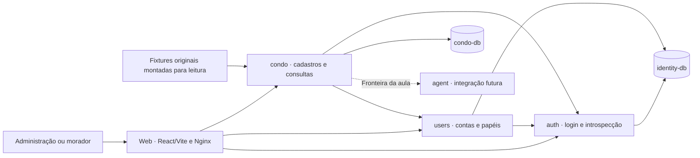
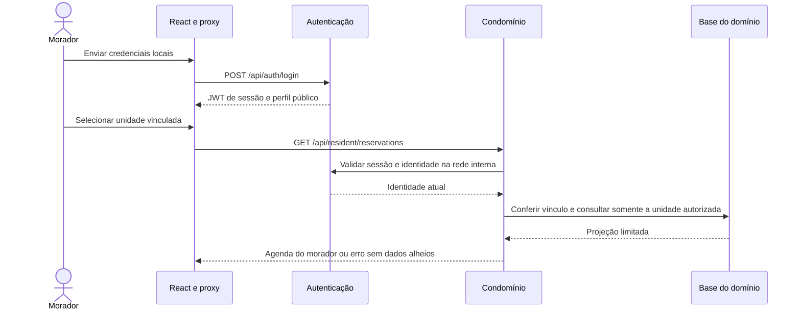
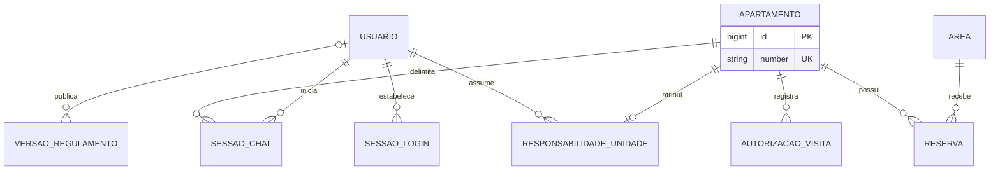

# Arquitetura do Residencial Aurora

O produto local usa React/Vite, tokens e componentes do Synapse, proxy Nginx, FastAPI e PostgreSQL. A unidade de isolamento de sessão é o apartamento autorizado. O sistema guarda papéis em identidade e estado do condomínio no domínio.

## Composição local

A configuração de publicação e portas fica na [raiz do projeto](../compose.yaml). Identidade, domínio e agente compartilham somente as interfaces privadas necessárias no Compose. Aplicações de domínio aplicam autorização por papel e vínculo após resolver a identidade. A composição base funciona sem provedor de modelos. O serviço de agente informa prontidão da fronteira e não executa intenções da aula.

## Fluxo autenticado

| Origem | Acesso |
| --- | --- |
| Administração | Gestão de usuários e responsáveis, cadastros, regulamento, agenda por área e horários de reservas e visitas |
| Morador | Identidade própria, unidades vinculadas, catálogo, regulamento vigente, reservas e autorizações da unidade e sessão de chat |
| Cliente sem sessão | Tela e login. Rotas privadas exigem JWT |
| Avaliador | Entrada local acadêmica reservada para a etapa guiada |

O JWT é um comprovante de sessão. A autorização depende de validação no serviço e de checagem de papel e recurso no consumidor. A sessão inválida retorna 401. Escopo insuficiente retorna 403. Falha em validar a identidade impede a operação. Nenhuma resposta de erro publica credenciais.

## Modelo de dados

O diagrama descreve relações lógicas. O banco de identidade guarda a conta e a sessão. O banco de domínio guarda vínculos e efeitos e usa o identificador público da conta entre as fronteiras. Uma unidade pode estar vaga ou ter um único responsável registrado em relação própria pelo código interno do apartamento. Neste escopo o responsável é o morador proprietário. As reservas referenciam a área, a unidade e o titular original. Guardam data e horário de início e término, com ocupação de uma área por dia. As autorizações de visita guardam data e horários de entrada e saída. O histórico permanece associado ao titular original quando o responsável pela unidade é trocado. A versão zero do regulamento vem dos dados iniciais. Operações com versão-base comparam o estado antes de publicar a nova revisão. Nenhuma ferramenta do agente ou tabela de pendências da aula está implícita neste diagrama.

## Interface

A interface usa os tokens de design do Synapse com ajustes locais do Aurora. O [inventário de telas](telas.md) mapeia navegação, papéis, chamadas e fluxos observáveis. O mesmo conjunto de superfícies aplica tipografia, contraste, foco e feedback a login, administração e jornada do morador. Mensagens de validação acompanham o formulário. Listas vazias e indisponibilidade são estados diferentes. A confirmação de exclusão administrativa é distinta da confirmação de negócio da futura conversa.

## Ativação do agente e da avaliação

No produto, a sessão autenticada fornece uma unidade. Na avaliação local, um adaptador acadêmico futuro cria a sessão a partir da unidade fornecida pelo avaliador. Ambos devem usar as regras de domínio, com portas externas separadas. A rota na porta 8000, as ferramentas, as confirmações e os eventos são verificados na fase de prática. [Contratos do chat](specs/F09-chat-agente/spec.md) · [Contratos do avaliador](specs/F10-avaliacao/spec.md)
