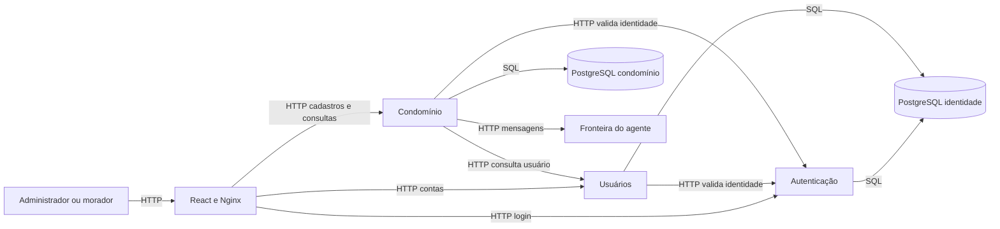
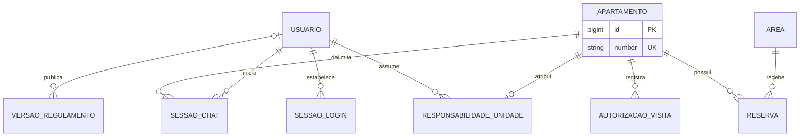

# Arquitetura — Residencial Aurora

> Estado: rascunho baseado na implementação existente.
> Escopo: base administrativa e portal autenticado.
> Fontes: [PRD](../prd/index.md), [composição](../../compose.yaml), [identidade](../../services/identity/app.py) e [domínio](../../services/domain/app.py).

## 1. Objetivo e limites

Descrever a base local com autenticação, cadastros e consultas de moradores. O agente principal, especialistas e o contrato acadêmico ainda dependem de implementação. A arquitetura atende aos requisitos F01–F14 e aos requisitos transversais do PRD.

## 2. Arquitetura geral

React/Vite entrega a interface por Nginx. FastAPI atende identidade e condomínio. A composição usa serviços de autenticação, usuários, condomínio e fronteira de agente, com PostgreSQL separado para identidade e domínio. O navegador usa uma origem HTTP, enquanto serviços e bancos se comunicam pela rede interna do Compose.

## 3. Componentes e responsabilidades

| Componente | Responsabilidade | Fronteira e dependências | Fonte |
| --- | --- | --- | --- |
| Web | Login, navegação, formulários e consultas | Proxy para APIs | web/src/app.jsx |
| Autenticação | Credenciais, JWT, sessão e saída | Banco identidade | services/identity/app.py |
| Usuários | Contas, papéis e proteção da última administração | Autenticação e banco identidade | services/identity/app.py |
| Condomínio | Unidades, vínculos, áreas, agenda, visitas e versões | Identidade e banco domínio | services/domain/app.py |
| Agente | Fronteira interna que sinaliza integração pendente | Token interno | services/agent/app.py |

## 4. Fluxos de requisições e dados

Login devolve JWT e perfil. A interface envia bearer nas chamadas privadas. O domínio consulta a identidade e verifica papel e vínculo antes de consultar ou alterar dados. A indisponibilidade da identidade impede a operação. Publicar regulamento exige versão-base atual; conflito retorna 409 sem substituir a edição vigente.

## 5. Modelo de dados conceitual

Uma conta moradora pode ser responsável por várias unidades. Uma unidade tem código interno estável, número único e até um responsável. Reservas e autorizações mantêm a titularidade histórica após troca de responsável. A versão do regulamento registra conteúdo, autor e instante de publicação. A sessão de chat associa usuário e apartamento.

## 6. Interfaces e integrações

Nginx publica as rotas de identidade e domínio. A introspecção e a fronteira de agente ficam internas. As [specs](../specs/index.md) detalham os contratos por funcionalidade. O adaptador acadêmico na porta 8000 permanece especificado em F10, sem estar implementado na composição atual.

## 7. Escala e disponibilidade

O alvo atual é execução local por Compose. Não há meta aprovada de carga ou disponibilidade de produção. A validação de identidade é síncrona e sua indisponibilidade bloqueia operações privadas. A persistência usa volumes PostgreSQL e a subida normal conserva o estado.

## 8. Segurança e privacidade

As APIs validam identidade, papel e escopo do recurso. As projeções do morador limitam os dados à unidade autorizada e à titularidade. Configuração secreta fica no ambiente. Rotas internas usam autenticação de serviço e não são publicadas pelo proxy. Dados iniciais ficam montados para leitura.

## 9. Observabilidade e operação

Health checks verificam prontidão das dependências no Compose. scripts/start.sh prepara configuração e sobe os serviços. Reinício preserva volumes; a carga inicial respeita registros existentes. A saúde do agente indica disponibilidade da fronteira interna. Mensagens retornam AGENT_NOT_CONFIGURED até a implementação da consultoria.

## 10. Decisões, riscos e validação

| Decisão | Origem | Estado | ADR ou justificativa sem ADR |
| --- | --- | --- | --- |
| Serviços separados de identidade e condomínio | PRD F01 e composição existente | Implementada | Registro de ADR deve qualificar a decisão e seus trade-offs antes de formalizar aceitação |
| Sessão vinculada a usuário e apartamento | PRD F09 e domínio | Implementada | Invariante de autorização detalhada na spec |
| PostgreSQL e volumes locais | Compose e schemas existentes | Implementada | Uso observado; implantação de produção depende de desenho próprio |

| Risco ou pendência | Impacto | Mitigação ou próxima decisão | Evidência |
| --- | --- | --- | --- |
| Agente e adaptador acadêmico pendentes | Desafio ainda incompleto | Implementar F09 e F10 segundo as specs | services/agent/app.py |
| Dependência síncrona de identidade | APIs privadas indisponíveis durante falha | Bloqueio por padrão e health checks | services/common.py |

### Verificações realizadas

As relações do documento foram conferidas contra Compose, código e modelos persistidos. Os diagramas descrevem o estado da base e não incluem ferramentas futuras como capacidades implementadas. A renderização dos diagramas ainda requer revisão visual.

### Handoff para especificação

As specs F01–F14 detalham as fronteiras acima. F07–F10 incluem operações futuras de agentes, confirmação e protocolo acadêmico que devem preservar os invariantes do domínio.
