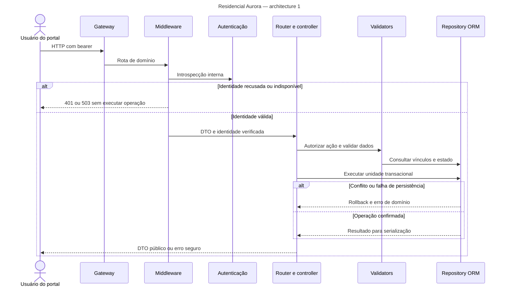
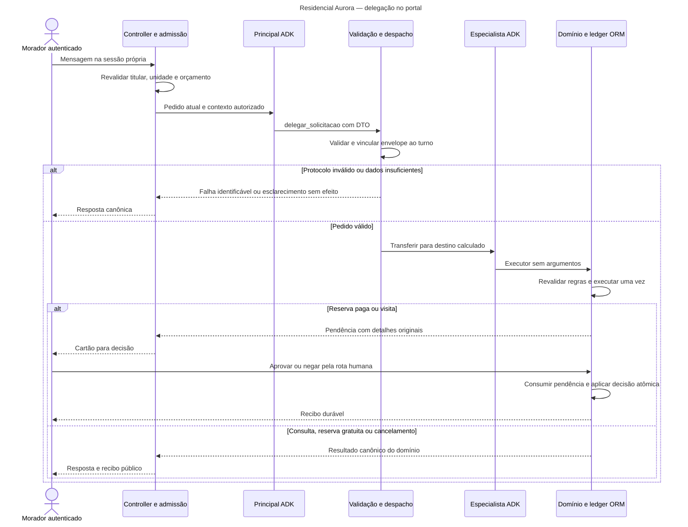
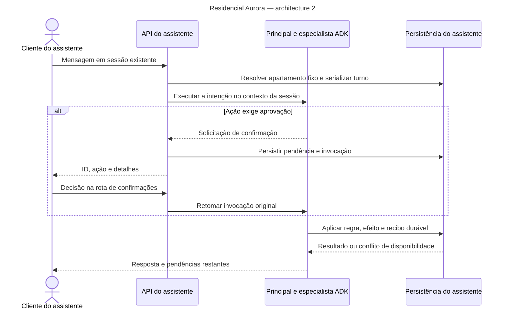

# Arquitetura — Residencial Aurora

> Estado: descrição da implementação; aceite funcional e humano definido pelos contratos das features.
> Escopo: portal autenticado, serviços de domínio, assistente e API do assistente.
> Fontes: [PRD](../prd/index.md), [composição](../../configs/compose.yaml), [specs](../specs/index.md) e [ADRs](../adr/README.md).

## 1. Objetivo e limites

O sistema atende à gestão do Residencial Aurora e ao desafio de assistência para reservas, visitas e regulamento. Administração e moradores usam o portal autenticado; o avaliador usa as seis rotas do assistente. As superfícies mantêm dados separados. Esta visão orienta desenvolvimento e revisão; os contratos de entrada, saída e aceite ficam nas specs F01–F14.

O modelo interpreta a intenção e escolhe ferramentas. Identidade, apartamento da sessão, validação, confirmação, persistência e exclusividade são responsabilidades do servidor e do armazenamento. Pagamentos reais, publicação em produção e garantias de compreensão universal do modelo ficam fora do escopo.

## 2. Arquitetura geral

Um único manifesto, `configs/compose.yaml`, compõe o frontend React/Nginx, oito APIs FastAPI de produto, seus bancos, preparadores de dados e a entrada do assistente com duas réplicas do agente e gateway local. Cada serviço possui Dockerfile e entrypoint. O manifesto Python e `uv.lock` ficam na raiz como metadados de distribuição; `infra/python/pyproject.toml` contém somente as regras Ruff; a configuração privada fica em `configs/.env`.

O portal acessa as APIs pela mesma origem. A identidade usa PostgreSQL próprio; os domínios de condomínio compartilham o banco de condomínio e mantêm seus repositories. Sessões/eventos ADK possuem persistência dedicada. A API do assistente usa PostgreSQL separado dos dados do portal.

As [visões C1/C2](c4-context.md) mostram atores, processos e armazenamentos. O ADR-0006 define os dois bancos do portal, o SQLite ADK dedicado e o PostgreSQL isolado do assistente.

## 3. Componentes e responsabilidades

| Componente | Responsabilidade | Fronteira e dependências | Fonte |
| --- | --- | --- | --- |
| Frontend | Navegação, painéis, cadastros, agenda e chat | HTTP pela origem do Nginx | services/frontend |
| authentication | Login, JWT, sessão revogável e introspecção | Banco de identidade; contrato interno | services/authentication |
| users | Contas, perfis e última administração ativa | Banco de identidade | services/users |
| apartments | Unidades, códigos e responsáveis | Banco de condomínio; projeção interna de usuários | services/apartments |
| common_areas | Áreas, taxas e referências históricas | Banco de condomínio | services/common_areas |
| agenda | Reservas, disponibilidade e horários | Exclusividade no banco de condomínio | services/agenda |
| visits | Autorizações de visita e horários | Banco de condomínio | services/visits |
| parameters | Regulamento vigente e revisões | Banco de condomínio | services/parameters |
| agent | Sessões, contexto, histórico, ferramentas e especialistas | Identidade, domínios e ADK/Gemini | services/agent |
| API do assistente | Contrato do avaliador, confirmação e projeções | Réplicas isoladas e PostgreSQL do assistente | services/agent/api |
| microservice-toolkit | Aplicação, middleware, erros, logs, health e ORM | Infraestrutura sem regras do residencial | infra/packages/microservice-toolkit |
| aurora-toolkit | Tipos, permissões, identidade e convenções do cluster | Contratos próprios do produto | infra/packages/aurora-toolkit |

As APIs de negócio usam routers, controllers, validators, repositories, models, schemas e serializers. O toolkit genérico fornece a infraestrutura; as regras e os modelos pertencem aos serviços. A API do assistente aplica o mesmo fluxo de camadas às seis rotas do enunciado, com models declarativos e repositories ORM transacionais para SQLite e PostgreSQL.

## 4. Fluxos de requisições e dados

No portal, o principal extrai a intenção do pedido atual por `delegar_solicitacao`. O servidor valida o DTO, fixa identidade/unidade e determina o especialista por mapa de operações. Reservas e convivência possuem, cada um, uma ferramenta executora sem argumentos; ela consome somente o envelope validado daquela sessão e turno. Respostas antigas do assistente não são fatos de autorização. O transcript permanece persistido e visível conforme a projeção pública.

As ferramentas de reservas consultam disponibilidade e reservas próprias e executam criação/cancelamento. Convivência trata visitas e regulamento. O backend produz a resposta a partir do resultado real; dados incompletos pedem esclarecimento e falha do protocolo retorna indisponibilidade sem efeito. Chamadas repetidas do executor recuperam o mesmo resultado do turno. A chave estável de proposta reutiliza a PK do ledger, sem novo schema ou DDL na partida HTTP. Não há transação de banco aberta durante chamadas ao modelo. O [ADR-0009](../adr/ADR-0009-delegacao-tipada-e-recibos-do-servidor.md) e a [spec F09](../specs/F09-chat-agente/spec.md#protocolo-interno-de-delegação) definem os contratos.

O fluxo seguinte descreve separadamente a API do assistente usada pelo avaliador.

A confirmação referencia o item original persistido; um “sim” no chat não substitui a decisão da rota. Negar não grava o efeito. Unicidade, consumo único e recibos duráveis protegem concorrência e repetição. O regulamento é consultado por artigo pertinente, sem incluir o documento integral no prompt principal.

A composição autenticada possui ledger de confirmação no banco de condomínio. Os efeitos locais fornecidos pelos domínios usam a mesma transação; isso não representa atomicidade distribuída por HTTP. Um desenho de outbox/inbox entre serviços exige decisão e contrato próprios.

## 5. Modelo de dados conceitual

O [modelo conceitual](data-model.md) descreve conta, unidade, responsabilidade, área, reserva, autorização, revisão do regulamento, sessão e confirmação. Trocar o responsável não transfere a titularidade histórica das reservas ou visitas. Uma área aceita uma única reserva ativa por data; cancelar conserva o código histórico.

Sessões, eventos e decisões sobrevivem ao reinício. O portal e a API do assistente usam armazenamentos separados, com as fixtures originais preservadas.

## 6. Interfaces e integrações

O portal publica `/api` com autenticação e autorização por papel e recurso. Os caminhos internos de identidade e agente não são publicados pelo gateway. Swagger e OpenAPI dos serviços ficam em `/services/NOME/docs` e `/services/NOME/openapi.json`.

A entrada do assistente está vinculada ao loopback na porta 8000 e oferece as seis rotas de F10: sessão, mensagem, confirmação, eventos, reservas e visitantes. Ela não autentica o avaliador e não encaminha operações para o banco do portal. Sua fronteira de confiança e exposição são diferentes das APIs autenticadas.

Google ADK 2.14.1 coordena a execução e o serviço de sessão persistente. Gemini usa o transporte Google AI Studio configurado por ambiente. Modelos injetados pertencem exclusivamente aos testes unitários. Segredos não integram imagens, fixtures, documentos, eventos públicos ou logs.

## 7. Escala e disponibilidade

O alvo é um cluster Compose local, sem SLA ou capacidade numérica de produção aprovados. As réplicas do assistente compartilham o PostgreSQL, que coordena turno, confirmação e exclusividade. As verificações unitárias com armazenamento injetado não certificam por si só as réplicas PostgreSQL ou Gemini.

A indisponibilidade da identidade bloqueia APIs privadas. Falhas do modelo tornam a conversa indisponível sem conceder um efeito. O banco decide a disputa pela reserva; uma fila de processamento não substitui a restrição de exclusividade.

## 8. Segurança e privacidade

O middleware autentica; validators autorizam ações e recursos. Schemas limitam os dados recebidos e serializers delimitam a saída pública. Senhas usam derivação Argon2. Desativação de conta ou mudança de vínculo deve ser verificada antes de uma operação privada.

A admissão persistente reserva a execução por sessão, morador e global antes de criar o modelo ou chamar o provedor. A consulta de histórico usa projeção persistente paginada por cursor, com limite na consulta ORM; não carrega todos os eventos ADK para cortar a resposta depois.

O portal apresenta uma única conversa contínua por titular e unidade, com histórico recuperado automaticamente e compositor no rodapé, sem gerenciador de conversas. Sessões autorizadas compõem a mesma linha do tempo. A sessão de chat fixa usuário e unidade. As tools revalidam elegibilidade e não aceitam apartamento livre escolhido pelo modelo. O histórico público contém mensagens e recibos destinados ao morador; eventos de auditoria não devem ser tratados como resposta pública da interface. O endpoint do assistente de eventos segue exclusivamente o contrato local do enunciado.

## 9. Observabilidade e operação

`make setup` prepara `configs/.env` sem sobrescrever a configuração existente. `make up` constrói e inicia o cluster de `configs/compose.yaml`; `make down` preserva os volumes. Cada serviço possui seu Dockerfile e entrypoint com propagação de sinais por `exec`. [ADR-0008](../adr/ADR-0008-cluster-unico-e-containers-por-servico.md) registra a organização.

Preparadores explícitos criam as tabelas atuais e importam as fixtures quando ainda inexistentes; repetir a preparação conserva registros existentes. A inicialização principal usa `services/initialize.py`; session-init executa a preparação ADK do portal e agent-init prepara ORM e ADK acadêmicos. Operações auxiliares pertencem a `infra/operations`. Alterações de schema existente exigem migração própria, sem restauração implícita.

O inventário de configuração e os procedimentos de prontidão e recuperação de cada serviço estão no [README](../../README.md#modos-prontidão-e-recuperação).

O lifespan do toolkit valida os nomes de configuração obrigatória declarados em `REQUIRED_SECRETS`. `/health` mede atividade do processo e não consulta banco. PostgreSQL tem seu próprio healthcheck; não há endpoint /ready: a prontidão operacional combina jobs concluídos, dependências saudáveis e uma operação autorizada de domínio. Histórico, ledger, admissão e sessões/eventos ADK são preparados explicitamente antes de HTTP; o lifespan fecha recursos e não cria tabelas.

Logs estruturados registram serviço, rota, método, status, duração e correlação. O ambiente de desenvolvimento pode fornecer diagnóstico técnico sanitizado; respostas públicas de produção não expõem traceback ou dados sensíveis. Resultados de testes, capturas, pareceres e roteiros de execução ficam fora do repositório.

## 10. Decisões, riscos e validação

| Decisão | Origem | Estado | ADR |
| --- | --- | --- | --- |
| Serviços e camadas | F01 | accepted | [ADR-0001](../adr/ADR-0001-servicos-por-dominio-e-camadas.md) |
| ORM e integridade transacional | F01/F07 | accepted | [ADR-0002](../adr/ADR-0002-orm-e-integridade-transacional.md) |
| Identidade central e autorização por recurso | F03/F04 | accepted | [ADR-0003](../adr/ADR-0003-identidade-central-e-autorizacao-por-recurso.md) |
| Infraestrutura HTTP compartilhada | F01 | accepted | [ADR-0004](../adr/ADR-0004-toolkit-e-operacao-dos-servicos.md) |
| Regulamento único versionado | F06 | accepted | [ADR-0005](../adr/ADR-0005-regulamento-unico-versionado.md) |
| Fronteiras de persistência do portal e assistente | F01/F09/F10 | accepted | [ADR-0006](../adr/ADR-0006-persistencia-compartilhada-da-base.md) |
| Framework e convenções do cluster | F01 | accepted | [ADR-0007](../adr/ADR-0007-framework-e-ciclo-de-vida.md) |
| Cluster único e containers por serviço | F01 | accepted | [ADR-0008](../adr/ADR-0008-cluster-unico-e-containers-por-servico.md) |
| Delegação tipada e recibos do servidor no portal | F07/F08/F09 | accepted | [ADR-0009](../adr/ADR-0009-delegacao-tipada-e-recibos-do-servidor.md) |

| Risco ou pendência | Impacto | Próxima verificação | Fonte |
| --- | --- | --- | --- |
| Banco de condomínio compartilhado | Acoplamento de esquema e disponibilidade | Verificar limites transacionais e indisponibilidade compartilhada | ADR-0006 |
| Resposta do modelo | Interpretação pode divergir da intenção | Avaliar frases e eventos reais do protocolo; regra permanece no servidor | F06–F10 |
| Versão de regulamento sem política de execução mapeada | A consulta não autoriza automaticamente novas escritas | Recusar o efeito até existir regra de execução aplicável | F06/F07/F08 |
| Confirmação e concorrência | Repetição ou interrupção pode disputar um efeito | Verificar recibos, transações e retomada nas réplicas reais | F07/F09/F10 |

### Validação e rastreabilidade

As fontes são composição, código, PRD e contratos versionados. Conferir links, coerência dos diagramas, fronteiras, build e runtime do candidato faz parte de sua avaliação. Resultados anteriores não concedem aceite ao corte atual. F01 governa a operação; F02–F06, cadastros e identidade; F07–F09, ferramentas e conversa; F10, as garantias do desafio; F11–F14, as jornadas da interface. O aceite humano permanece uma decisão explícita.

O gateway da API do desafio resolve dinamicamente os nomes das duas réplicas pelo DNS interno do Docker, com atualização a cada cinco segundos e estado de upstream compartilhado. A recriação de uma réplica não exige reiniciar o gateway. Requisições de alteração não são repetidas automaticamente em outra réplica.
