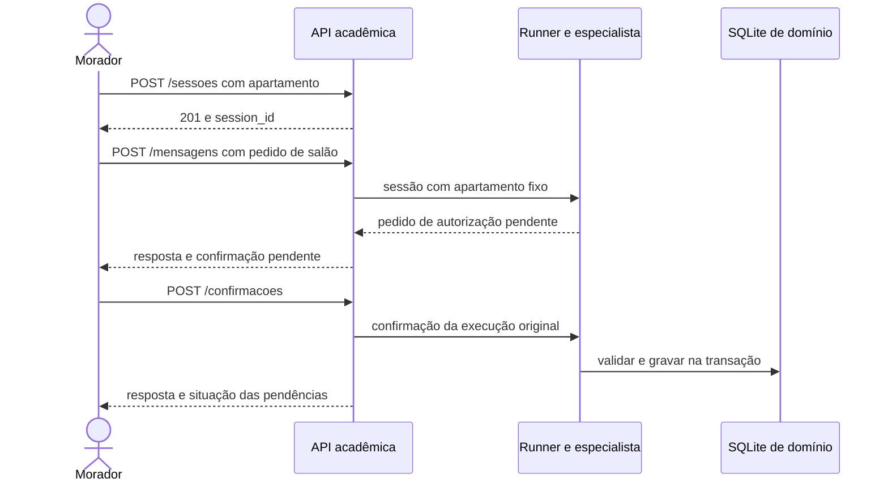

# Residencial Aurora: roteiro de demonstração do avaliador

Este roteiro é para o modo acadêmico local, com os dados fictícios de `dados/`. Não use a API acadêmica como portal do condomínio: ela não exige autenticação e expõe rotas de verificação para o avaliador. Não exponha a porta de avaliação na rede.

## A conversa e o efeito no banco são duas evidências diferentes



Abra `http://localhost:8000/docs` após iniciar o modo acadêmico conforme o README. O Swagger é um cliente de teste, não um requisito de interface do desafio. Para entender cada etapa, confira a resposta do chat e as rotas de consulta/eventos em separado.

## Roteiro, em ordem

1. **Dados de partida.** Restaure apenas o banco acadêmico. A reserva inicial `RSV-1377` aparece em `GET /apartamentos/101/reservas`. Crie uma sessão para o apartamento 101 em `POST /sessoes`; guarde o `session_id`.
2. **Ação gratuita.** Envie `POST /sessoes/{session_id}/mensagens` com `{"texto":"Reserve a quadra para 2030-04-06."}`. Compare o antes/depois em `GET /apartamentos/101/reservas`: não deve haver pendência e a quadra deve aparecer.
3. **Ação paga ainda pendente.** Peça o salão para `2030-04-20`. Veja o `id` da pendência, a área e a data em `confirmacoes_pendentes`. Nesta altura, a rota de reservas não pode listar o novo salão.
4. **Negação e aprovação.** Responda pela rota `POST /sessoes/{session_id}/confirmacoes` com `{"id":"<id>","confirmado":false}`: a reserva continua ausente. Repita o pedido, copie o novo ID e confirme com `true`. Deve haver uma única reserva para esse salão/data. Repetir a aprovação já consumida deve retornar 409 sem efeito extra.
5. **Visita e regulamento.** Peça uma visita fictícia, confirme pela rota e confira nome/data na verificação. Em seguida, pergunte sobre o horário da piscina no domingo. Examine se o retorno traz a regra pertinente e se os eventos não carregam os outros capítulos.
6. **Reinício e disputa.** Anote a quantidade de eventos, pare e suba a API sem restaurar o banco. O mesmo ID deve manter o histórico. Em uma janela de testes separada, duas sessões podem solicitar o mesmo slot pago; após as duas aprovações, só deve existir uma reserva ativa para aquela área/data.

Este roteiro não substitui os [15 passos do enunciado](../enunciado.md#fluxo-do-avaliador). Ao registrar resultados, distinga: (a) HTTP + ADK com modelo fake e dados fictícios; (b) o mesmo fluxo com Gemini; (c) instalação em clone limpo. Um teste de um grupo não prova o outro. Não registre tokens, valores de `.env` ou dados pessoais nos prints.


## Lendo o código em seis etapas

### 1. A sessão fixa a unidade

Em [`api.py`](../../services/agent/academic/api.py), `POST /sessoes` valida a unidade e persiste o vínculo. Cada turno consulta esse vínculo no servidor. As tools recebem um objeto com a unidade fixada, não um campo que o modelo pode preencher:

```python
# runtime.py, dentro da composição da sessão
bound = domain.tools(apartment)

def listar_reservas() -> dict:
    """Consulta reservas do apartamento fixo da sessão."""
    return bound.listar_reservas()
```

### 2. O principal encaminha, o especialista age

Veja `LlmAgent` e `sub_agents` em [`runtime.py`](../../services/agent/academic/runtime.py). Reservas atende agenda e cancelamentos; convivência atende visitas e regulamento. A transferência acontece na mesma sessão. Consulte `GET /sessoes/{session_id}/eventos` para ver quem chamou cada tool e seu resultado, em vez de deduzir o caminho pelo texto final.

### 3. Uma ação paga para no meio do turno

```python
# runtime.py: trecho da função decision
context.request_confirmation(
    hint="Aprovar ou negar pela rota de confirmações.",
    payload={"acao": action, "detalhes": proposal["detalhes"]},
)
return {"status": "pending_external_confirmation"}
```

Na primeira passagem, área, data e taxa foram validadas, mas a reserva paga não existe no banco. A API salva a pendência e devolve seu ID. Visita segue a mesma ideia. Reserva gratuita e cancelamento próprio dispensam confirmação.

### 4. A decisão externa retoma a execução original

```python
# api.py: row["invocation"] aponta para o turno original.
events = await run(session_id, content, row["invocation"])
```

O **ID da pendência** identifica a decisão na API. O **ID da execução do ADK** indica ao Runner qual turno retomar. Se a execução falhar, confira histórico e efeito antes de pedir outra vez: a API não envia de novo automaticamente uma decisão já recebida.

### 5. O banco decide a disputa

```sql
CREATE UNIQUE INDEX one_active_reservation
ON reservations(area, day) WHERE active = 1;
```

Veja `_insert_reservation` e `_once` em [`domain.py`](../../services/agent/academic/domain.py). O índice parcial protege o slot no INSERT. O recibo impede repetir o efeito da mesma operação. Uma garantia arbitra dois pedidos diferentes pelo mesmo slot; a outra protege a repetição do mesmo pedido.

### 6. Persistência não é só histórico de chat

`domain.db` guarda o vínculo da sessão, as pendências e os efeitos. `sessions.db` guarda os eventos do ADK. Feche e reabra usando o **mesmo** diretório para provar persistência. Escolha um diretório **novo** só quando quiser recomeçar com os dados oficiais.

## Onde ler os testes

- [`test_academic_domain.py`](../../services/agent/tests/test_academic_domain.py) testa transação, recibo, cancelamento e concorrência entre processos.
- [`test_academic_api.py`](../../services/agent/tests/test_academic_api.py) atravessa FastAPI, Runner, tools, confirmação e SQLite. O modelo é injetado para tornar o roteamento determinístico; não mede a interpretação de texto do Gemini.

A [demo anterior na porta 8793](http://127.0.0.1:8793/) é de consultas. Para os comandos da avaliação, use a API na porta 8000 ou a porta explicitamente informada no teste. Uma URL local só responde enquanto a instância estiver rodando.
