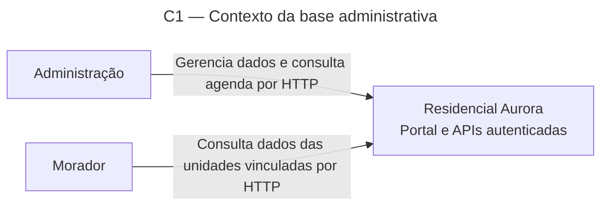
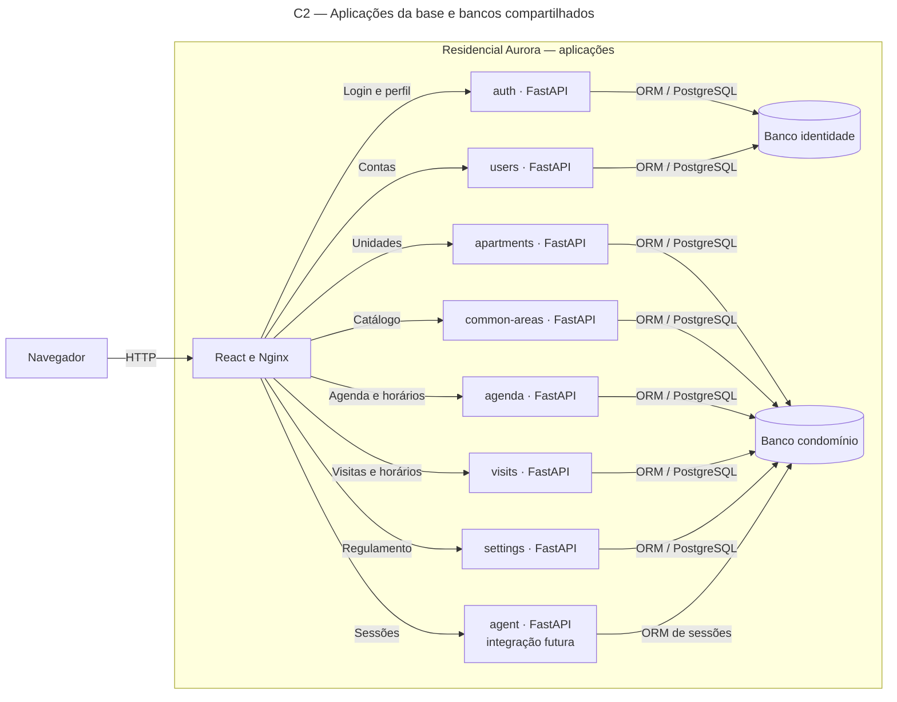

# Contexto e aplicações — base administrativa

Estas visões C4 respondem quem usa o sistema e quais aplicações atendem a operação manual. Público: desenvolvimento e revisão do produto. Fontes: [PRD](../prd/index.md), [composição](../../compose.yaml), [gateway](../../web/nginx.conf), [ADR-0001](../adr/ADR-0001-servicos-por-dominio-e-camadas.md) e [ADR-0006](../adr/ADR-0006-persistencia-compartilhada-da-base.md). São projeções revisáveis da topologia implementada.

## C1 — limite do sistema

A administração gerencia contas, apartamentos, áreas e regulamento e consulta reservas e visitas. O morador usa consultas restritas aos seus vínculos. Não há provedor de modelos necessário para a base manual.

O operador local prepara o ambiente por Makefile/Compose; ele não é um ator de negócio do portal. A integração com Google ADK/Gemini e o adaptador acadêmico pertencem à próxima etapa. O contexto atual não representa uma fila, worker ou modelo como componente já entregue.

## C2 — aplicações e persistência

| Aplicação | Tecnologia | Responsabilidade e fronteira |
| --- | --- | --- |
| Portal e gateway | React e Nginx | Interface, navegação e encaminhamento HTTP na mesma origem |
| Autenticação | FastAPI | Credencial, JWT, sessão revogável e introspecção interna |
| Usuários | FastAPI | Contas, dados públicos e proteção da última administração |
| Apartamentos | FastAPI | Unidades e responsável atual |
| Áreas comuns | FastAPI | Catálogo e taxa |
| Agenda | FastAPI | Projeções de reservas e horários administrativos |
| Visitas | FastAPI | Autorizações existentes e horários |
| Configurações | FastAPI | Regulamento vigente e versões |
| Fronteira do agente | FastAPI | Sessões persistidas e indisponibilidade explícita da integração |
| Identidade | PostgreSQL | Contas e sessões; compartilhado por auth/users |
| Condomínio | PostgreSQL | Unidades, vínculos, áreas, reservas, visitas, regulamento e sessões de chat |

As sete aplicações consumidoras consultam auth por HTTP interno para verificar identidade antes das operações privadas. Apartamentos também consulta a projeção interna de usuários para validar o responsável. Esses contratos são documentados em F02/F03/F04. O gateway não publica os caminhos internos. A separação de aplicações não implica um banco por serviço.

O toolkit é uma dependência Python dessas aplicações, não um processo HTTP separado. Ele fornece autenticação de transporte, logs, correlação, erros e health; a aplicação define autorização de negócio e prontidão. O [fluxo de requisição](architecture.md#4-fluxos-de-requisições-e-dados) detalha a ordem das camadas e recusas.
