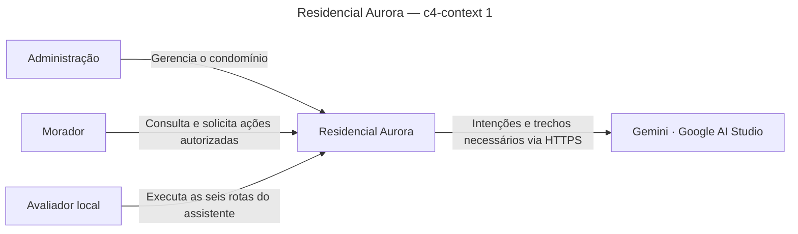
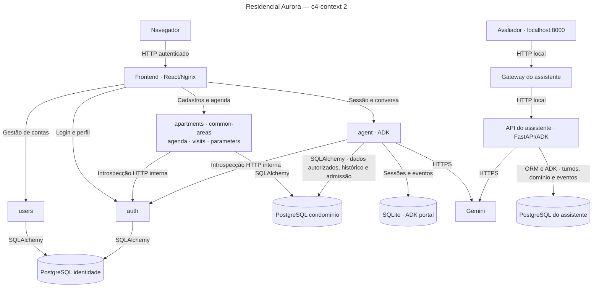

# Contexto e aplicações — Residencial Aurora

Público: desenvolvimento e revisão. As visões respondem quem usa o sistema e quais processos atendem ao portal e à avaliação. Fontes: [PRD](../prd/index.md), [composição](../../configs/compose.yaml), [gateway do portal](../../services/frontend/nginx.conf) e [ADRs](../adr/README.md).

## C1 — limite do sistema

A administração mantém contas, apartamentos, áreas, regulamento e horários; o morador acessa suas unidades e o assistente. O avaliador usa a interface do assistente isolada. O operador prepara o ambiente por Makefile/Compose. Pagamentos reais e deploy público não integram esta arquitetura.

## C2 — aplicações e persistência

| Aplicação ou armazenamento | Responsabilidade e fronteira |
| --- | --- |
| Frontend React/Nginx | Interface e roteamento autenticado na mesma origem |
| auth e users | Identidade, JWT, contas e introspecção interna |
| apartments e common-areas | Unidades, responsáveis e catálogo de áreas |
| agenda, visits e parameters | Reservas, autorizações e revisões do regulamento |
| agent | Sessões do morador, contexto, histórico e tools autorizadas |
| Gateway e aplicação do assistente | Contrato local do avaliador, turnos ADK e confirmações |
| PostgreSQL de identidade | Contas e sessões de login do portal |
| PostgreSQL de condomínio | Cadastros, domínio e estado de conversa do produto |
| Persistência ADK do portal | Sessões/eventos do runtime do assistente |
| PostgreSQL do assistente | Domínio, pendências, recibos e sessões/eventos do assistente |
| Jobs de preparação | Schema atual, fixtures e recursos antes dos servidores |

A aplicação acadêmica é executada em duas réplicas no Compose; essa escolha de implantação compartilha o mesmo banco, sem alterar as fronteiras C2.

Os gateways e armazenamentos mantêm separadas as superfícies do assistente e do portal. A API do assistente não usa o banco do portal. O contexto do modelo é vinculado à sessão pelo servidor. A exclusividade da reserva é imposta no armazenamento compartilhado pelas réplicas.

Os toolkits são dependências Python das aplicações: `microservice-toolkit` fornece infraestrutura; `aurora-toolkit`, convenções de identidade e domínio do cluster. Não são processos HTTP. Os preparadores finitos criam o schema atual e importam dados ausentes; não restauram volumes em uma partida normal. A operação e os fluxos estão na [arquitetura](architecture.md).
