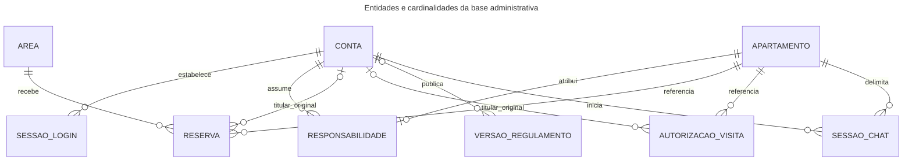

# Modelo conceitual — base administrativa

Público: desenvolvimento e revisão das regras de dados. Pergunta: quais identidades e vínculos devem ser preservados quando a administração altera um cadastro? Fontes: modelos em services, [F02](../specs/F02-apartamentos/spec.md), [F04](../specs/F04-usuarios/spec.md), [F06](../specs/F06-regulamento/spec.md), [F07](../specs/F07-reservas/spec.md), [F08](../specs/F08-visitantes/spec.md) e [ADR-0002](../adr/ADR-0002-orm-e-integridade-transacional.md).

## Entidades, identidade e limites

| Entidade | Identidade | Limite e invariantes |
| --- | --- | --- |
| Conta | id estável; email único normalizado | Nome, papel admin/resident e estado ativo; senha derivada não integra projeção pública. Desativar preserva histórico e revoga sessões |
| Sessão de login | id próprio ligado à conta | Validade e revogação verificadas na autoridade de identidade; token não altera a titularidade |
| Apartamento | id interno estável e número único | Pode existir sem responsável; exclusão/renumeração com histórico é recusada |
| Responsabilidade | apartamento_id | No máximo um morador responsável por unidade; um morador pode responder por várias unidades |
| Área comum | id estável e nome único | Taxa em centavos, nunca negativa; referência histórica limita exclusão |
| Reserva | código único histórico | Área, unidade, data, titular original, taxa histórica, estado e horários opcionais; uma reserva ativa por área/data |
| Autorização de visita | id próprio | Vinculada à unidade e ao titular original, com nome e data; não equivale a convidado de uma reserva. Horário de saída exige entrada anterior |
| Versão de regulamento | versão sequencial | Um texto vigente, versão zero importada, autor e horário; publicação acrescenta versão e preserva as anteriores |
| Sessão de chat | UUID próprio | Conta e unidade fixadas ao criar; exige vínculo atual. A integração ADK não está implementada nesta base |

Relações entre conta e dados do condomínio são lógicas: os dois bancos não suportam foreign key cruzada. Validators e contratos internos verificam elegibilidade; a consulta do morador exige vínculo atual e titularidade histórica. O ER conceitual não implica constraint física entre bancos.

## Efeitos das alterações administrativas

- Trocar o responsável não transfere reservas ou autorizações antigas ao novo responsável. A administração conserva as projeções históricas; o morador consulta somente o que continua autorizado.
- Renumerar ou excluir uma unidade referenciada não pode tornar a história órfã. A API converte a recusa de integridade em conflito de domínio.
- Excluir área referenciada não apaga reservas. Alterar taxa não reescreve o valor histórico de uma reserva.
- Alterar senha ou desativar conta revoga suas sessões. A última administração ativa é protegida dentro da transação, inclusive sob concorrência.
- Publicar regulamento exige a versão atual esperada. Duas edições concorrentes não podem sobrescrever uma à outra; a vencida recebe conflito.
- Horários de reservas usam início e fim juntos e em ordem; visitas permitem entrada sem saída, mas não saída sem entrada anterior.

## Preparação para o desafio

O índice parcial de exclusividade já existe no armazenamento. A futura tool ainda precisará tratar a colisão e responder indisponibilidade sem erro de servidor, proteger códigos históricos, confirmação de cobrança/acesso e idempotência. Não há garantia de fluxo do agente concluído porque uma constraint esteja presente. Eventual fila e seus estados serão avaliados no blueprint posterior.
