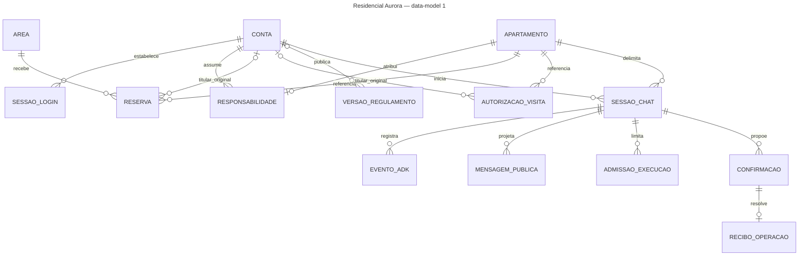

# Modelo conceitual — Residencial Aurora

Público: desenvolvimento e revisão das regras de dados. Fontes: [arquitetura](architecture.md), modelos em services, [F02](../specs/F02-apartamentos/spec.md), [F04](../specs/F04-usuarios/spec.md), [F06](../specs/F06-regulamento/spec.md), [F07](../specs/F07-reservas/spec.md), [F08](../specs/F08-visitantes/spec.md), [F09](../specs/F09-chat-agente/spec.md) e [F10](../specs/F10-avaliacao/spec.md).

## Entidades, identidade e limites

| Entidade | Identidade | Limite e invariantes |
| --- | --- | --- |
| Conta | id estável; email único normalizado | Papel, nome e estado ativo; senha derivada não integra projeção pública |
| Sessão de login | id ligado à conta | Validade e revogação verificadas pela autoridade de identidade |
| Apartamento | id estável e número único | Pode existir sem responsável; operações administrativas preservam referências históricas |
| Responsabilidade | apartamento_id | Até um responsável por unidade; uma conta pode responder por várias unidades |
| Área comum | id e nome únicos | Taxa não negativa; uma reserva ativa por área/data |
| Reserva | código único histórico | Unidade, área, data, titular original, taxa, estado e horários; cancelamento conserva o código |
| Autorização de visita | id próprio | Unidade, titular original, nome, data e horários; não representa convidado de reserva |
| Versão de regulamento | número sequencial | Um texto vigente; versão zero importada; revisões conservam conteúdo, autor e instante |
| Sessão de chat | UUID próprio | Unidade fixa; no portal também possui dono e vínculo vigente obrigatório |
| Evento ADK | id do evento e sessão | Ordem, papel, mensagem e execução persistidos; projeção pública filtra conteúdo interno |
| Mensagem pública | id e sequência de cursor | Sessão, papel user/assistant, texto público e instante; página limitada no repository |
| Admissão de execução | escopo e lease | Limite de sessão, morador e global reservado antes do provedor e liberado ao terminar |
| Confirmação | id e sessão | Item original, ação, detalhes, estado e decisão; uma decisão não é autorização para outro item |
| Recibo de operação | chave idempotente do efeito | Resultado durável ligado à ação; repetição não produz um novo efeito |

As relações entre a identidade e o condomínio são lógicas: bancos distintos não possuem foreign key cruzada. Validators e contratos internos verificam elegibilidade. A consulta do morador exige vínculo atual e titularidade histórica.

O diagrama é conceitual: a materialização difere entre portal e interface do assistente e não cria constraints físicas entre os seus bancos.

## Efeitos das alterações administrativas

- Trocar o responsável não transfere reservas ou autorizações antigas ao novo responsável.
- Renumerar ou excluir uma unidade referenciada não torna seu histórico órfão; referências impedem exclusão incompatível.
- Excluir área referenciada não apaga reservas. Alterar taxa não reescreve valores históricos.
- Alterar senha ou desativar conta revoga sessões. A última administração ativa é protegida dentro da transação.
- Publicar regulamento exige a versão atual esperada. Uma edição concorrente não sobrescreve a revisão já publicada.
- Horários de reservas usam início e fim juntos e em ordem. Visitas permitem entrada sem saída, mas não saída sem entrada anterior.

## Conversa, confirmação e exclusividade

O portal e a API do assistente fixam o apartamento na abertura da sessão. O modelo recebe ferramentas com esse contexto e não escolhe outra unidade por texto ou argumentos. Eventos persistidos permitem acompanhar a transferência entre principal e especialistas. Na API do assistente, também registram a retomada da invocação ADK após uma confirmação.

A ação pendente conserva o item proposto. Na API do assistente, a aprovação externa retoma a execução ADK original. No portal, a rota de decisão recupera a pendência do ledger e executa o efeito validado diretamente, sem nova chamada ao modelo. Negar não executa o efeito. Consumo único, transação e recibos protegem contra reenvio e interrupção. A restrição de reserva ativa por área e data decide uma corrida entre sessões; consultar disponibilidade previamente não substitui essa restrição.

No portal, o ledger e os efeitos locais usam a transação do banco de condomínio. Na API do assistente, domínio, sessões e eventos ficam no armazenamento próprio do avaliador. Nenhuma dessas fronteiras concede transação distribuída a chamadas HTTP externas.

No portal, a proposta usa uma chave UUID gerada pelo servidor por turno e a PK existente do ledger. Repetir o mesmo escopo, ação e payload recupera a mesma pendência ainda não decidida; divergência ou item consumido retorna conflito. O envelope transitório vincula interpretação e executor, sem substituir a pendência durável nem alterar o schema. O [ADR-0009](../adr/ADR-0009-delegacao-tipada-e-recibos-do-servidor.md) registra essa decisão.

## Persistência e restauração

Reiniciar o cluster conserva cadastros, sessões, eventos, pendências e efeitos nos volumes configurados. A inicialização não restaura dados existentes.

A restauração do assistente é uma operação explícita, limitada ao armazenamento do avaliador e confirmada pelo operador. Ela repõe reservas e visitantes a partir dos arquivos originais e invalida sessões do assistente anteriores para evitar que uma pendência antiga reaplique um efeito ao estado restaurado. Não modifica os arquivos em dados nem os bancos do portal. O contrato operacional está em F10.
