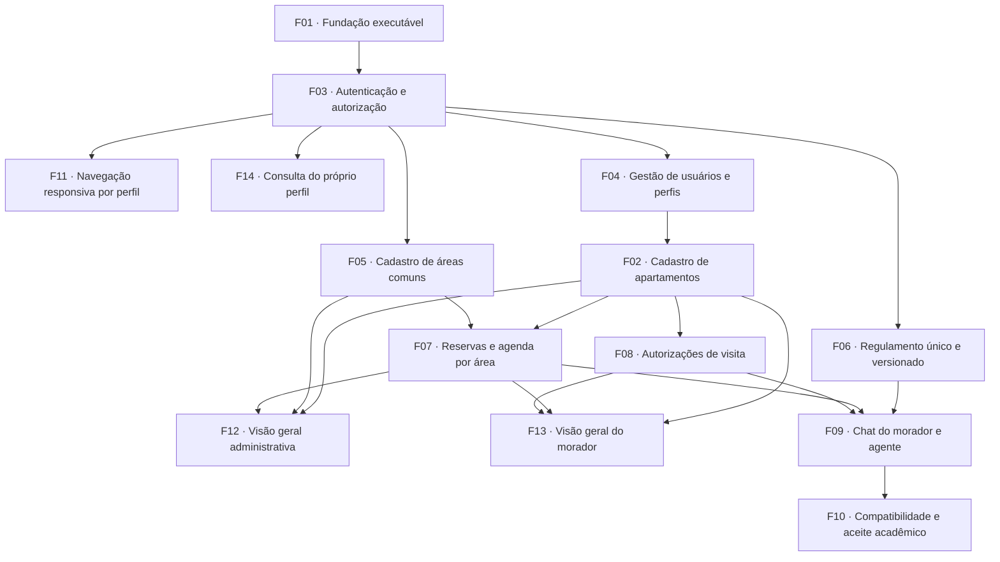

# PRD — Residencial Aurora

## 1. Sumário executivo

O Residencial Aurora reúne cadastros do condomínio, agenda e contas em um produto autenticado. Administração mantém usuários, vínculos, áreas comuns e o texto vigente. Moradores consultam somente dados de unidades vinculadas. A base inclui a sessão autenticada do chat para avançar para a integração de agentes. A integração das tools, o provedor de modelos e o adaptador acadêmico têm uma etapa de implementação posterior.

## 2. Problema e oportunidade

| Problema | Consequência | Proposta |
| --- | --- | --- |
| Dados iniciais em arquivos estáticos | Atualizações de gestão ficam dispersas e manuais | Importar fixtures uma vez e operar cadastros e versões no banco |
| Uma conta se vincula a mais de uma unidade | A identidade da conta sozinha não determina a agenda autorizada | Validar o vínculo nas consultas e fixar a unidade por sessão |
| Ações de chat podem cobrar ou autorizar acesso | Um pedido mal interpretado pode gravar um efeito indevido | Na integração, implementar confirmação e regras de domínio testáveis fora do modelo |
| Produto e avaliador usam entradas diferentes | Rotas locais do avaliador não devem virar atalhos do produto | Manter a entrada acadêmica futura isolada do proxy autenticado |

A linha de base de tempo de cadastro e esforço de operação ainda não foi medida. Os critérios abaixo são resultados esperados e provas executáveis.

## 3. Público-alvo

- **Administração:** mantém os cadastros, quem responde por cada unidade e o regulamento. Consulta a agenda por área e registra horários de reservas e visitas.
- **Morador:** usuário que representa o proprietário e responsável pela unidade. Seleciona uma unidade sob sua responsabilidade, consulta suas reservas e visitas e abre a futura jornada de assistência.
- **Pessoa em aprendizagem:** implementa e inspeciona a orquestração, tools e retomada uma etapa por vez.
- **Avaliador:** executa o contrato local acadêmico depois da implementação do agente.

## 4. Objetivos e métricas de sucesso

| Objetivo | Métrica e método | Meta ou estado |
| --- | --- | --- |
| Preparar a base local | Conferir serviços saudáveis e abrir login pelo proxy | Uma execução de Compose em ambiente limpo |
| Controlar operações por papel e recurso | Executar casos negativos e comparar estado anterior e posterior | Nenhum efeito indevido nos cenários especificados |
| Preservar cadastro e versões | Editar, reiniciar e comparar conta, proteção do histórico e regimento | Revisões e dados confirmados preservados |
| Concluir integração de agentes | Verificar ações gratuitas, pagas, recusa, reinício, consulta e corrida | Provas da integração pendentes da implementação |
| Cumprir o protocolo acadêmico | Registrar saída e projeções dos 15 passos do avaliador | Execução posterior à integração de agentes |

Requisitos não funcionais: [NFR01](non-functional/NFR01-seguranca.md), [NFR02](non-functional/NFR02-durabilidade.md), [NFR03](non-functional/NFR03-privacidade.md), [NFR04](non-functional/NFR04-operacao.md).

## 5. Histórias de usuário

- [F01](functional/F01-fundacao.md) — Como operador, quero subir o ambiente local com um comando para testar o produto sem configurar um provedor de modelos.
- [F03](functional/F03-autenticacao.md) — Como usuário do residencial, quero entrar com minhas credenciais e ter acesso às operações do meu papel.
- [F04](functional/F04-usuarios.md) — Como administrador, quero criar perfis de moradores e corrigir seus dados para manter os acessos do residencial.
- [F05](functional/F05-areas.md) — Como administrador, quero manter áreas e taxas atualizadas para que morador e agenda consultem o catálogo correto.
- [F06](functional/F06-regulamento.md) — Como administrador, quero publicar novas versões do regulamento e saber quem alterou cada versão e quando.
- [F02](functional/F02-apartamentos.md) — Como administrador, quero vincular apartamentos a moradores para que cada conta possa selecionar somente as unidades que ocupa.
- [F07](functional/F07-reservas.md) — Como morador, quero consultar reservas da unidade selecionada e depois aprender a solicitar reservas e cancelamentos pelo assistente.
- [F08](functional/F08-visitantes.md) — Como morador, quero consultar autorizações da minha unidade e depois autorizar uma visita por uma ação confirmada.
- [F09](functional/F09-chat-agente.md) — Como morador, quero abrir o chat em uma unidade vinculada. A integração com o domínio deve preservar o contexto da sessão.
- [F10](functional/F10-avaliacao.md) — Como avaliador, quero executar o protocolo documentado em ambiente local isolado e verificar as garantias pelas rotas e pelos dados.

- [F11](functional/F11-navegacao.md) — Oferecer acesso aos caminhos autorizados por perfil, com barra lateral compacta no desktop e menu modal no celular.

- [F12](functional/F12-painel-administrativo.md) — Consolidar os totais de cadastros e os atalhos de gestão para iniciar a operação administrativa.

- [F13](functional/F13-painel-morador.md) — Mostrar ao morador o resumo de sua unidade selecionada e os caminhos para consultas e assistente.

- [F14](functional/F14-perfil.md) — Permitir que cada conta confira nome, e-mail e tipo associados à sessão corrente.

## 6. Funcionalidades

| ID | Funcionalidade | Domínio | Onda | Prioridade | Cerimônia | Arquivo |
| --- | --- | --- | --- | --- | --- | --- |
| F01 | Fundação executável | Operação | 1 | 1 | full | [F01](functional/F01-fundacao.md) |
| F03 | Autenticação e autorização | Segurança | 2 | 1 | full | [F03](functional/F03-autenticacao.md) |
| F04 | Gestão de usuários e perfis | Administração | 3 | 1 | full | [F04](functional/F04-usuarios.md) |
| F05 | Cadastro de áreas comuns | Administração | 3 | 1 | full | [F05](functional/F05-areas.md) |
| F06 | Regulamento único e versionado | Administração | 3 | 1 | full | [F06](functional/F06-regulamento.md) |
| F02 | Cadastro de apartamentos | Administração | 4 | 1 | full | [F02](functional/F02-apartamentos.md) |
| F07 | Reservas e agenda por área | Reservas | 5 | 1 | full | [F07](functional/F07-reservas.md) |
| F08 | Autorizações de visita | Acesso ao residencial | 5 | 1 | full | [F08](functional/F08-visitantes.md) |
| F09 | Chat do morador e agente | Agentes | 6 | 1 | full | [F09](functional/F09-chat-agente.md) |
| F10 | Compatibilidade e aceite acadêmico | Integração | 7 | 1 | full | [F10](functional/F10-avaliacao.md) |
| F11 | Navegação responsiva por perfil | Interface | 3 | 1 | full | [F11](functional/F11-navegacao.md) |
| F12 | Visão geral administrativa | Administração | 6 | 1 | full | [F12](functional/F12-painel-administrativo.md) |
| F13 | Visão geral do morador | Morador | 6 | 1 | full | [F13](functional/F13-painel-morador.md) |
| F14 | Consulta do próprio perfil | Conta | 3 | 1 | full | [F14](functional/F14-perfil.md) |

Os códigos originais de produto FR01 a FR10 correspondem, pela ordem, a F01 a F10 nesta cópia. Os ACs originais mantêm o número no requisito correspondente. Novos critérios separam a prova da base da prova do agente e da avaliação. O [índice das specs](../specs/index.md) lista as etapas de cada entrega.

## 7. Fora do escopo

- Múltiplos condomínios, pagamentos reais, estornos e cancelamento administrativo de reservas.
- Cadastro de outros ocupantes da unidade, separação entre proprietário e responsável, controle de comparecimento, documentos e convidados associados a reservas.
- Publicação em produção, programa de identidade externo e chave real de provedor na base.
- Misturar o caminho acadêmico futuro com as rotas autenticadas do produto.

## 8. Grafo de dependências

| ID | Dependências | Onda |
| --- | --- | --- |
| F01 | Nenhuma | 1 |
| F03 | F01 | 2 |
| F04 | F03 | 3 |
| F05 | F03 | 3 |
| F06 | F03 | 3 |
| F02 | F04 | 4 |
| F07 | F02, F05 | 5 |
| F08 | F02 | 5 |
| F09 | F06, F07, F08 | 6 |
| F10 | F09 | 7 |
| F11 | F03 | 3 |
| F12 | F02, F05, F07 | 6 |
| F13 | F02, F07, F08 | 6 |
| F14 | F03 | 3 |

### Fundação

F01 entrega a composição e a persistência, incluindo o ponto de integração do agente. F03 resolve identidade e permissão antes de habilitar cadastros e as consultas. A base publica a sessão de chat quando as consultas de domínio estão disponíveis. A orquestração e o avaliador são etapas posteriores.

### Ondas de execução

- Onda 1: composição e saúde da base.
- Onda 2: login, identidade e fronteiras de autorização.
- Onda 3: usuários, áreas, regulamento, navegação por perfil e perfil pessoal.
- Onda 4: apartamentos e vínculos.
- Onda 5: agenda, reservas e autorizações de visita com prova de leitura e escopo.
- Onda 6: painéis administrativo e morador, sessão de chat e integração das ferramentas.
- Onda 7: executar o contrato acadêmico isolado.

### Legenda de prioridades

Prioridade 1 identifica requisitos da entrega pretendida. A etapa de cada evidência indica se ela pertence à base pronta, à integração ou à integração acadêmica.

### Diagrama

## 9. Critérios de aceite

- [F01](functional/F01-fundacao.md#critérios-de-aceite) — Distribuir uma base local que compile, inicie e permita verificar separadamente as superfícies de identidade, cadastros, interface e futura integração do agente.
- [F03](functional/F03-autenticacao.md#critérios-de-aceite) — Emitir uma sessão autenticada e validar identidade e permissão antes de operações privadas, incluindo bloqueio quando a identidade estiver indisponível.
- [F04](functional/F04-usuarios.md#critérios-de-aceite) — Cadastrar, editar, desativar e consultar usuários dos tipos Administração e Morador, com proteção à última administração ativa.
- [F05](functional/F05-areas.md#critérios-de-aceite) — Permitir CRUD de áreas e taxa não negativa, com escopo administrativo e preservação de referências históricas.
- [F06](functional/F06-regulamento.md#critérios-de-aceite) — Exibir o texto vigente, publicar um histórico ordenado e imutável e rejeitar edição concorrente sobre base desatualizada.
- [F02](functional/F02-apartamentos.md#critérios-de-aceite) — Cadastrar, consultar, editar o vínculo e remover unidades sem comprometer o histórico do condomínio.
- [F07](functional/F07-reservas.md#critérios-de-aceite) — Consultar reservas no calendário por área, localizar por código e registrar horários. Criar e cancelar reservas no fluxo de integração.
- [F08](functional/F08-visitantes.md#critérios-de-aceite) — Consultar autorizações existentes por papel e registrar horários de entrada e saída. Criar nova autorização confirmada na integração.
- [F09](functional/F09-chat-agente.md#critérios-de-aceite) — Entregar o contêiner do chat e os contratos de sessão da base. Orientar a implementação do agente, suas tools e confirmação pela API.
- [F10](functional/F10-avaliacao.md#critérios-de-aceite) — Definir a fronteira da API avaliada e os procedimentos para validar o desafio quando a integração de agentes estiver concluída.

- [F11](functional/F11-navegacao.md#critérios-de-aceite) — Oferecer acesso aos caminhos autorizados por perfil, com barra lateral compacta no desktop e menu modal no celular.

- [F12](functional/F12-painel-administrativo.md#critérios-de-aceite) — Consolidar os totais de cadastros e os atalhos de gestão para iniciar a operação administrativa.

- [F13](functional/F13-painel-morador.md#critérios-de-aceite) — Mostrar ao morador o resumo de sua unidade selecionada e os caminhos para consultas e assistente.

- [F14](functional/F14-perfil.md#critérios-de-aceite) — Permitir que cada conta confira nome, e-mail e tipo associados à sessão corrente.

### Integração entre funcionalidades

- A identidade resolvida por F03 permite criar contas em F04 e vinculá-las em F02. O morador passa a ver somente as unidades legítimas.
- A agenda F07 usa unidade e área de F02 e F05. A consulta devolve o recorte permitido e a exclusão de cadastro mantém o histórico referenciado.
- O chat F09 abre sessão numa unidade validada e usa os contratos de domínio de F06 a F08 para orientar a futura aula. Confirmação e eventos são observados no protocolo F10 depois do agente implementado.
