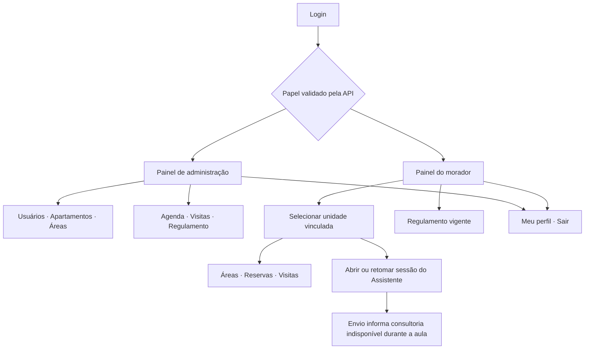

# Telas e design system

O portal é servido pelo proxy local em `http://127.0.0.1:8767/`. As rotas com `#` são navegação no React. Links e chamadas da interface usam a mesma origem.

## Navegação

## Acesso comum

| Tela | Navegação | Comportamento e conexão |
| --- | --- | --- |
| Login | Raiz sem uma sessão válida | Envia email e senha à API de login. Exibe uma mensagem quando a entrada é inválida ou a autenticação falha. O papel devolvido pela sessão define a área inicial. |
| Meu perfil | `#/perfil` | Mostra nome, email e papel do perfil corrente. O menu de cada papel oferece o acesso a esta tela. |
| Sair | Botão na barra da conta | Revoga a sessão pela API e volta ao login após a resposta. |

## Administração

| Tela | Navegação | Fluxo |
| --- | --- | --- |
| Visão geral | `#/inicio` | Mostra resumos dos cadastros e atalhos para o espaço administrativo. |
| Usuários | `#/admin/usuarios` | Cria usuários dos tipos Administração e Morador, edita dados, desativa e reativa contas. |
| Apartamentos | `#/admin/apartamentos` | Exibe código, número e morador responsável. Permite cadastrar a unidade e atribuir um único usuário morador. A exclusão verifica dependências históricas. |
| Áreas comuns | `#/admin/areas` | Cadastra identificador, nome e taxa em reais. A interface envia centavos inteiros e indica área gratuita quando a taxa é zero. |
| Agenda | `#/admin/reservas` | Exibe um mês com reservas por área, navegação por setas e retorno a hoje. Um clique no dia abre a lista de reservas com responsável, unidade e horário. Buscar pelo código abre o mês, a área e a reserva. |
| Visitas | `#/admin/visitas` | Exibe autorizações de visita e permite registrar os horários de entrada e saída. |
| Regulamento | `#/admin/regulamento` | Apresenta texto vigente, editor, publicação e histórico. Se a versão-base mudou, o formulário exibe conflito com ação para carregar a versão atual. |

## Morador

| Tela | Navegação | Fluxo |
| --- | --- | --- |
| Visão geral | `#/inicio` | Oferece atalhos conforme as unidades da conta. Use o seletor da barra para definir o contexto das próximas consultas. |
| Áreas comuns | `#/areas` | Exibe catálogo autenticado, taxa e indicação de gratuidade. |
| Minhas reservas | `#/reservas` | Consulta as reservas da unidade ativa e seus horários, com escopo verificado no servidor. |
| Visitas | `#/visitas` | Consulta autorizações da unidade ativa e seus horários de entrada e saída, com escopo verificado no servidor. |
| Regulamento | `#/regulamento` | Renderiza somente a publicação vigente em leitura. |
| Assistente | `#/assistente` | Abre ou retoma sessão persistida da unidade, recebe mensagem e apresenta o estado de integração. Mudar o seletor abre um contexto de tela para a unidade escolhida. As sessões anteriores preservam o respectivo apartamento. |

## Design system

O [componente de calendário mensal](../web/src/calendar.jsx) recebe o mês (`YYYY-MM`), eventos com `id`, `date`, `title` e opcionais `subtitle`, `time` e `tone`, e funções de navegação e seleção. A tela de agenda fornece os dados e decide como abrir os detalhes. Outro cadastro pode reutilizar a grade mensal e conectar suas próprias ações.

- A interface carrega [tokens do Synapse](../web/src/synapse/tokens.css), estilos dos componentes e o [tema do Aurora](../web/src/styles/theme.css) nessa ordem. A personalização do projeto fica no tema e na [folha da aplicação](../web/src/styles/app.css).
- [Button](../web/src/synapse/Button.tsx) e [Alert](../web/src/synapse/Alert.tsx) sustentam ações e mensagens. Formulários, tabelas, títulos e tags reutilizam as convenções de [componentes de interface](../web/src/ui.jsx).
- Os fluxos usam rótulos de campos, estado de navegação e indicação de foco. Em telas pequenas o menu usa controle de expansão e as tabelas mantêm leitura pelo contêiner.
- Cada tela distingue carregamento, resultado vazio e falha. Os erros de ação aparecem junto da operação. Textos recebidos da API são renderizados como conteúdo da interface.

## Jornadas para conferência

1. **Administração.** Entre, crie um morador, vincule uma unidade, cadastre uma área, consulte agenda, publique uma versão do regulamento e confira a anterior no histórico.
2. **Morador.** Entre em outra sessão, selecione a unidade, confira reservas e visitas, consulte o regulamento, abra o Assistente, recarregue a página e retome a sessão.
3. **Fronteira do agente.** Envie uma pergunta pela sessão existente e observe a indisponibilidade. A [prática guiada](roteiro-agente.md) começa conectando a primeira consulta real.

[Arquitetura](arquitetura.md) · [Specs e contratos](specs/index.md) · [Provas executadas](validacao.md)

## Marca do portal

Login, barra lateral e menu móvel usam o mesmo logo de branding/logo.svg, distribuído em web/src/assets/aurora-logo.svg com nome de arquivo versionado pelo build do frontend. O link da marca preserva seu nome acessível e permanece visível no modo compacto.
